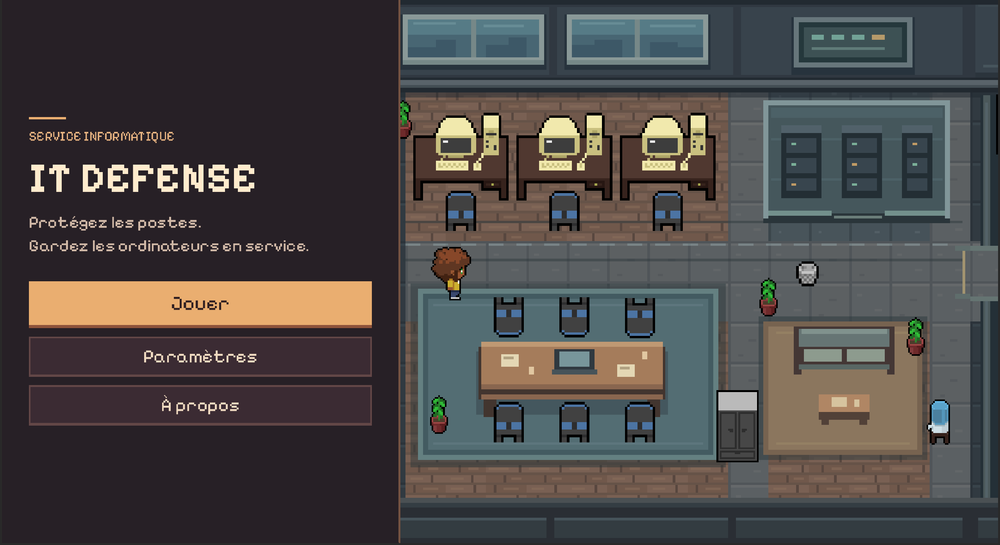
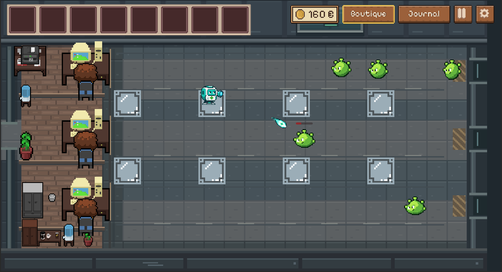
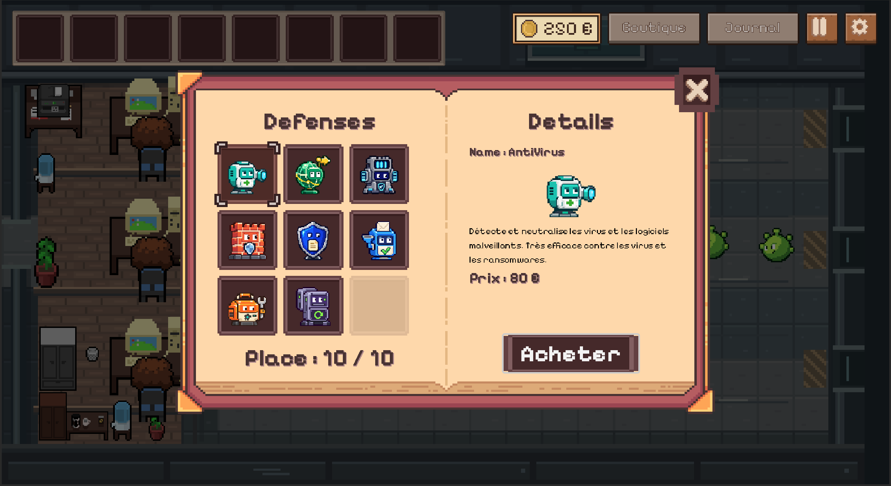

# IT Defense

**Protect the office. Keep the computers running!**

An educational **pixel-art tower defense game** about cybersecurity, built with **Godot**.

**[Play in your browser or download the game on itch.io](https://doublejean.itch.io/it-defense)**

The game is available in French, playable in the browser and downloadable for Windows and Linux.

## Gameplay

Protect office computers from a variety of cybersecurity threats. Buy defenses, place them on the available slots, and adapt your strategy to the incoming dangers.

Each defense can counter **one or more types of threats**, with effectiveness varying by target. Combine complementary defenses and position them to cover the adjacent lanes.

Working computers regularly generate money. A successful intrusion temporarily shuts down a workstation and stops its income. Repeated intrusions extend its downtime.

**To complete a day, repel every wave and finish with at least the required balance.** Find the right balance between investing in defenses and saving enough money to meet your goal.

## Features

- An interactive tutorial covering how to buy, place, and manage defenses.
- Three in-game days with progressively introduced threats.
- A shop and an inventory with stackable defenses.
- Defenses with different targets and effectiveness levels.
- Quizzes and a threat journal to learn about threats and protective measures.
- Options to view information about placed defenses or remove them.
- Transitions between days and results showing blocked threats and successful intrusions.
- A pause menu, volume controls, and background music.

## Screenshots

A defense in action against incoming threats:

The shop and defense information:

## Team

A student project developed for the **HAI921I — Serious Games** course at the **University of Montpellier**.

- Yaqi Zhang
- Robin Dejean
- Rémi Bonnafé

